# MetaGPT Service Instance Deployment Document

## Overview
MetaGPT is a framework based on the large language model (LLM). The MetaGPT can output user stories/competition analysis/requirements/data structures/APIs/files by inputting only one sentence of requirements. The MetaGPT includes the product manager/architect/project manager/engineer, which provides the whole process of a software company with well-tailored SOP.
At present, the computing nest has been installed with MetaGPT based on open source code. You only need to select the cloud server (ECS) parameters on the creation page, and the computing nest will automatically create a cloud server with MetaGPT for you. After the creation is complete, you only need to log in to the ECS to use the MetaGPT. This topic describes how to activate MetaGPT services on the computing nest, as well as the deployment process and usage instructions. If any problems are found during use, feedback is welcome.

## Explanation

-The MetaGPT is a community open source version. For the source code, see [Github Repo](https://github.com/geekan/MetaGPT).
-This service depends on the OpenAI GPT-4 API. Please prepare your OpenAI Key in advance.

## Deployment process

### 0. Preparations

Before you start using it, you need an Alibaba Cloud account to access and create resources such as ECS and VPC.

-If you use a personal account, you can directly create a service instance.
-If you use a RAM user to create a service instance and this is the first time you use Alibaba Cloud Compute
-Before creating a service instance, you must add the corresponding resource permissions to the account of the RAM user. For details about how to add RAM permissions, see [Grant RAM Users
Right](https://help.aliyun.com/document_detail/121945.html). The required permissions are shown in the table below.
-You need to authorize the creation of an associated role. For more information, see the following figure and select **Agree to Authorize and Create Associated Role**.

| Permission policy name | Comment |
| ------------------------------------- | ----------------------------------- |
| AliyunECSFullAccess | Permissions to manage ECS instances |
| AliyunVPCFullAccess | Permissions to manage a VPC |
| AliyunROSFullAccess | Manage permissions for Resource Orchestration Service (ROS) |
| AliyunComputeNestUserFullAccess | Manage user-side permissions for the compute nest service (ComputeNest) |
| AliyunCloudMonitorFullAccess | Permissions to manage CloudMonitor |

Secondly, because the bottom layer of the MetaGPT calls the large model GPT-4 of OPENAI, you also need to register the account of OPENAI in advance, which has the permission to call GPT-4.

### 1. Deployment portal

You can search for "MetaGPT Multi-Agent Framework Community Edition" on your own at the Alibaba Cloud Computing Nest, or you can reach it quickly through the following deployment link.

[Deployment Link](https://computenest.console.aliyun.com/user/cn-hangzhou/serviceInstanceCreate?ServiceId=service-8b04daf2d1ef43938199)

### 2. Create a MetaGPT service instance

#### 2.1 parameter list

When you create a service instance, you need to configure the parameter list of the service instance information, as follows.

| Parameter Group | Parameter Item | Example | Description |
| ------------ | ----------------- | ----------------------------------------------------------------------------------------------------------------- |
| Service instance name | N/A | test | Name of the instance |
| Region | N/A | China (Hangzhou) | Select the region of the service instance. We recommend that you select the region nearby to obtain better network latency. |
| Payment Type Configuration | Payment Type | Pay-As-You-Go | Select the payment type based on the actual situation |
| ECS instance configuration | Instance type | ecs.g6.large | Select the instance type based on the actual situation |
| ECS instance logon information | Instance password | ******** | Set the instance password. It is 8 to 30 characters in length and must contain three items (uppercase letters, lowercase letters, numbers, ()'~! @#$%^& *_-+ ={}[]:;'<>,.?/ |
| OPENAI configuration | OPENAIKey | sk-xxx | OPENAI key. If you use the key, MetaGPT will be deducted from the account corresponding to the key. This key is provided by OPENAI. Alibaba Cloud does not handle this key. The default model is used in GPT-4. Log in to [OpenAI official website](https://openai.com/). |
| Availability Zone Configuration | Availability Zone | Availability Zone I | Different Availability Zones in the region. Ensure that the instance is not empty. |
| VPC Settings | Whether to create a VPC | Yes | If yes, the computing nest will automatically create a VPC and Vswitch. If no, enter the created VPC and Vswitch. |
| VPC Settings | VPC Instance ID | vpc-xxx | Select the VPC ID as required. |
| VPC Settings | VSwitch Instance ID | vsw-xxx | Select the VSwitch ID as required. If the switch cannot be found, try to switch the region and zone. |

#### 2.2 specific steps

Create a service according to the following steps, refer to the following figure:

-The name of the created instance. It is not required.
-Select the region, as shown in the following figure, "Singapore"

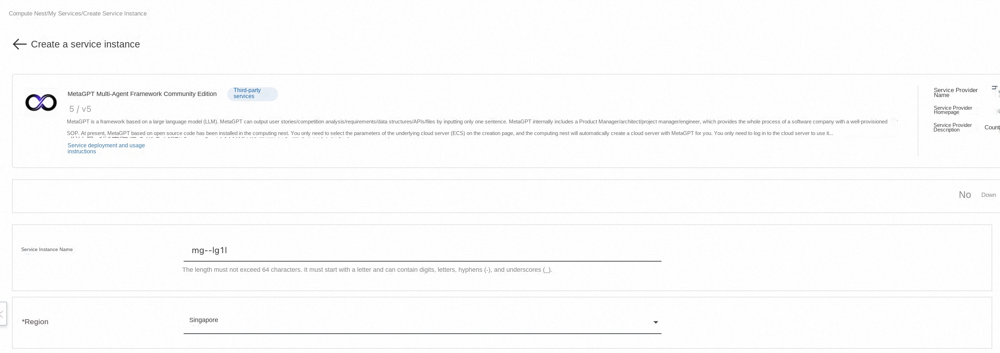

-Select Instance Type: ecs.g6.large is selected by default
-Configure the password for the instance

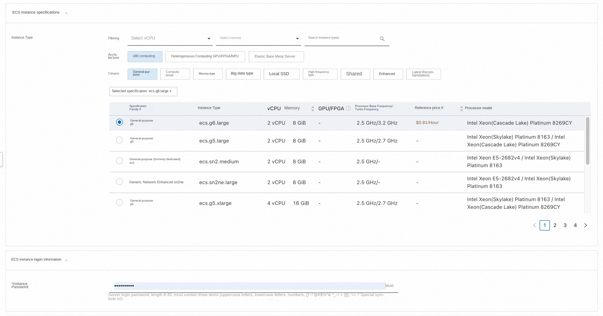

-OPENAIKey: Enter the OPENAIKey corresponding to the OPENAI account in the format of "sk-......". The calculation nest only passes this OPENAIKey into the MetaGPT as the API call credential, and does not perform any operations such as recording, verification, and authentication. To ensure normal subsequent use, ensure that the account corresponding to this key has access permissions and sufficient balance.
-Select the deployment area, as shown in "Availability Zone A" in the figure below"
-VPC Settings: optionally create or fill in an existing VPC/Vswitch

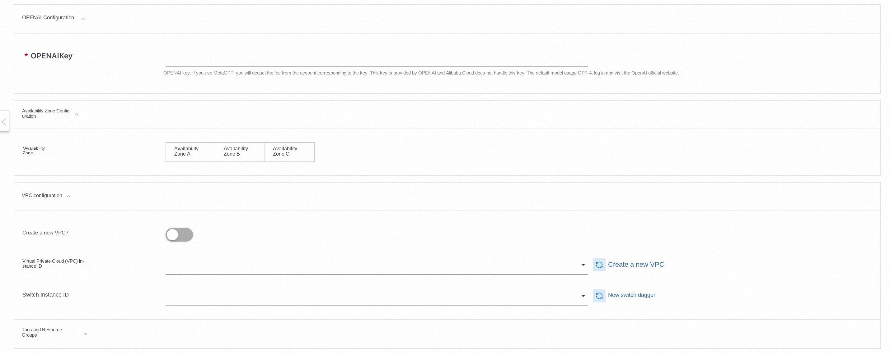

-Click Next to enter the order confirmation page
-Check the box in "I have read and agree to the Computing Nest Service Agreement"
-Click Create Now in the lower left corner to create a service instance

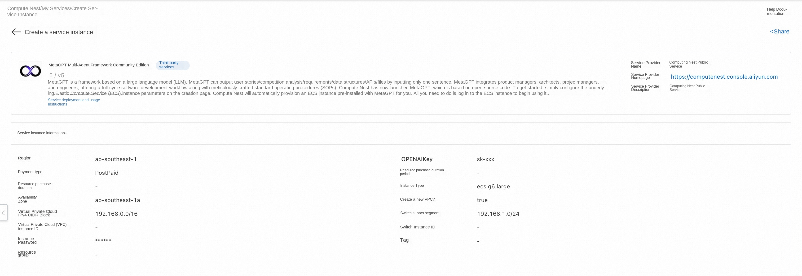
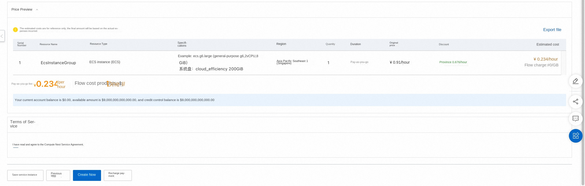

### 3. Start the MetaGPT service

-View the service instance: After the service instance is created, the deployment time takes 1 to 2 minutes. After the deployment is completed, the corresponding service instance can be seen on the page, as shown in the following figure

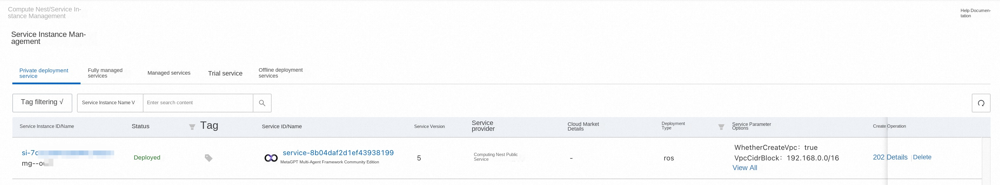

-Click on the service instance to access the service instance details.

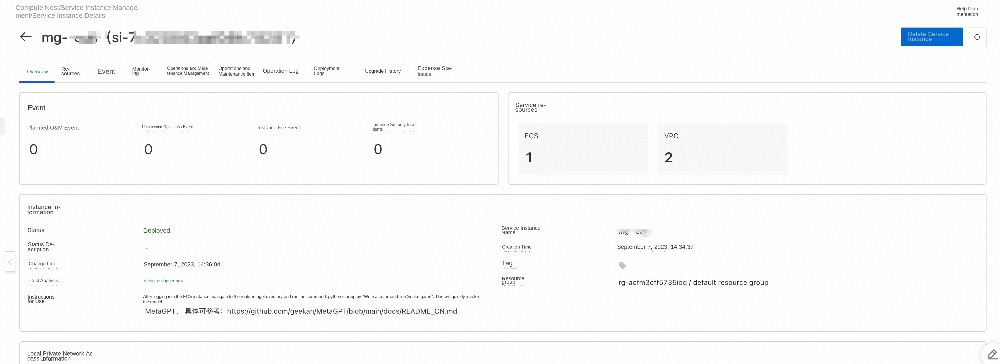

-Since the MetaGPT is executed from the command line, you need to log in to Ecs and click: Resources-Remote Connection-Secret-Free Login:

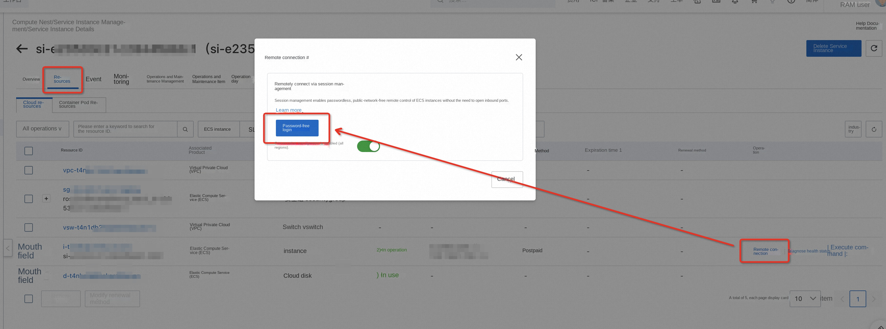

-Select the public network-After entering the password, you can enter the Ecs:

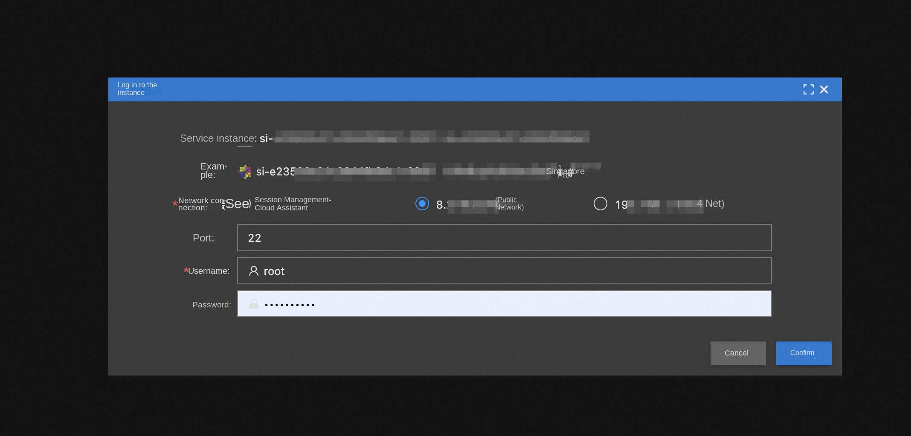

-After entering, the default is root directory: enter the command to enter the metagpt folder: cd metagpt/
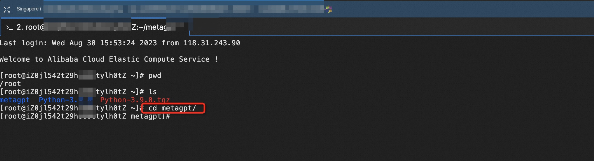

-execute commands such as: python startup.py "write a command line greedy snake" to call MetaGPT

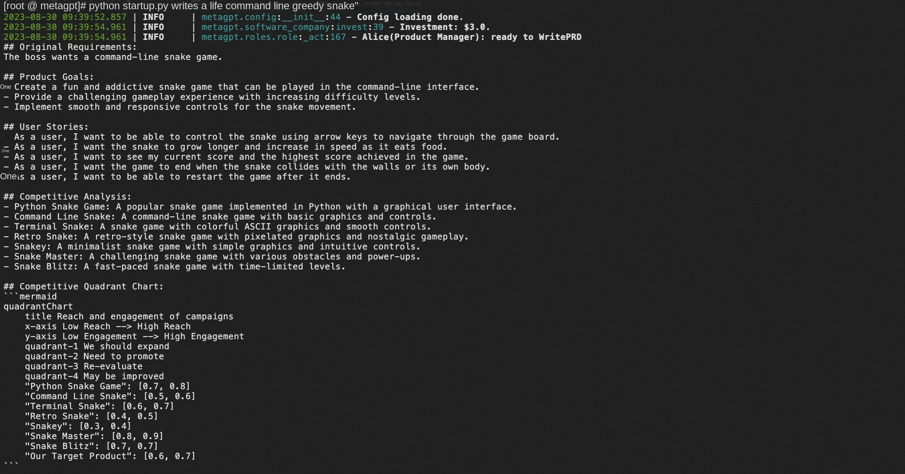

For more functions, please refer to [MetaGPT Usage Document](https://github.com/geekan/MetaGPT/blob/main/docs/README_CN.md)

